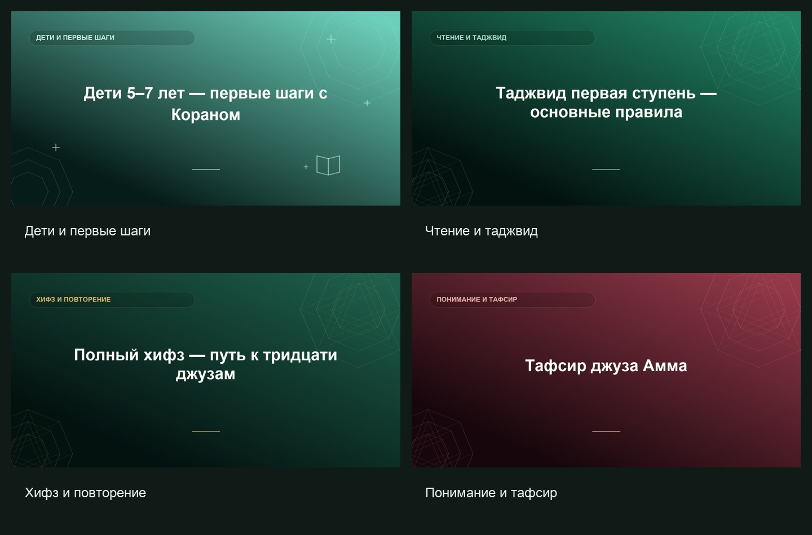
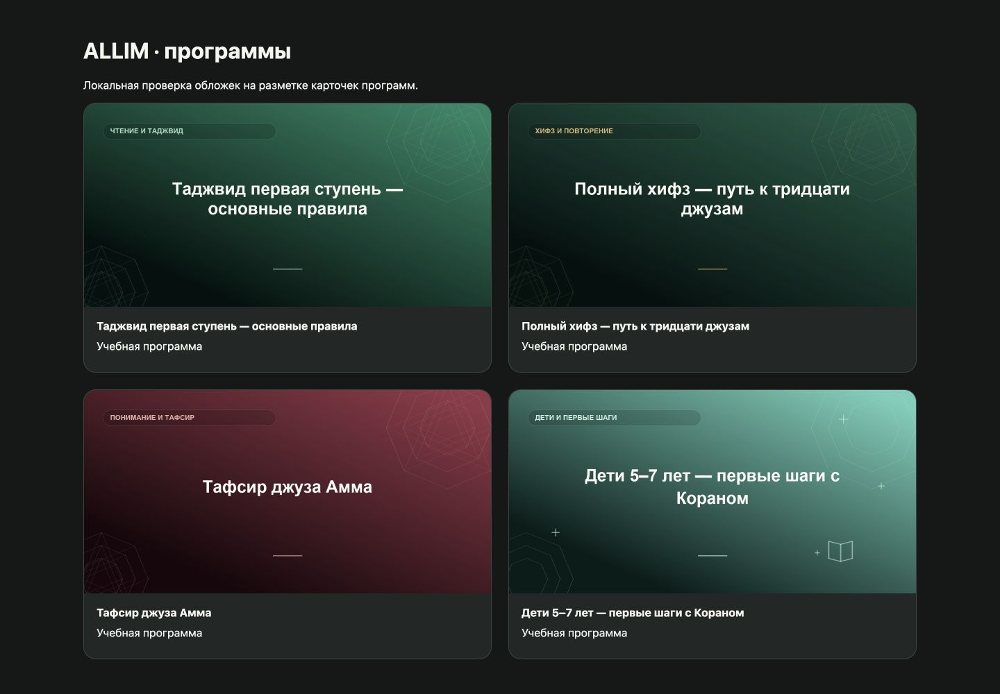
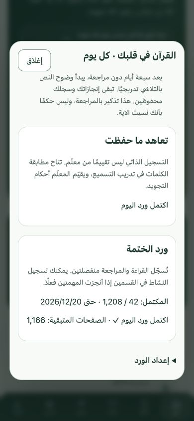

# Heart review, daily routes and Academy covers — 22 November 2026

## Result

“Collect the Quran in your heart” now separates the earned achievement from its current visibility. The first seven elapsed days since a recorded review do not fade. Visibility then decreases continuously to a 5% maintenance floor on day 35. A clean practice or explicit self-reported review restores the earned visibility, including partially collected ayahs. Counters, completed pages and historical records are never reduced. Missing dates ask for a check without inventing when an ayah was forgotten. This calendar model is a reminder, not a measurement of memory.

The home and Hifz screens open a daily route. A learner reviews up to five collected ayahs; a hafiz reviews the least recently reviewed pages over a 7-, 15- or 30-day circuit. Missed days do not skip pages. The separate reading route schedules one 604-page khatm over a calendar month or two independent khatms over an explicitly selected 29/30-day Ramadan. The user selects the start date; no moon-sighting date is inferred. Completed pages are unioned within each reading cycle, and today's work reduces today's quota. A changed date/mode creates new cycles while preserving earlier journal history.

Self-reports and existing client word-matching evidence are labelled separately. Hinted, partial, failed and reading-only recall attempts do not refresh memorization. A page-range review refreshes a crossing ayah only once all its pages have been reviewed. No new AI service or pronunciation score is introduced. Reminders are inside the application; email, push and background notification services are not included.

Four original cover families distinguish children/first steps (mint), reading/tajwid (emerald), hifz/review (dark green/gold), and understanding/tafsir (burgundy). The manifest contains 42 current course identities, eight pathway titles and three exact legacy title variants. Course images use an explicit preview/apply command. Program cards are decorated by an ALLIM-owned adapter because they do not expose a cover field. It matches exact known titles on the observed card markup and leaves unrecognized markup unchanged. Shared application sources are untouched.

## Source and integration

The owner explicitly approved `main` at `24a9b74403ee8052f325dba3511d5442fd4d00c6` with PR #7 at `a2ad3807988455f59c49dee3fb8e537788a9112f`, and separately approved the ALLIM-owned card integration. Merge `0fa26ea` reconciles these sources and retains main's account/session guards. This branch therefore includes the remaining PR #7 changes as well as this task. Coordinate their merge order; do not reset or close the earlier work automatically.

New record kinds use the existing private storage service: immutable `heart_review` facts and a versioned `devotional_plan/current`. Cycle references are checked within the current account, rejected drafts do not count as accepted progress, and explicit guest import remaps the cycle IDs. There is no new database table. Existing generation/session stamps guard pending UI writes.

## Reviewer installation on an agreed local test site

Do not install an arbitrary newer runtime. The exact environment manifest still needs agreement; the source approval above is not environment approval.

1. Integrate the approved source/PR #7 changes, back up the local test site, and run the existing read-only source drift guard:

   ```sh
   bench --site allimquran.localhost execute allimquran.setup.preflight
   ```

   Reconcile any drift before proceeding; do not bypass the guard.

2. Run the normal reviewed migration/content sync and asset publication process. The existing migration hook syncs app-owned page sources; the explicit command is:

   ```sh
   bench --site allimquran.localhost execute allimquran.setup.sync
   ```

   Ship the storage validators, page sources and new JS/CSS together. Static cover JPGs and their manifest are already included in the package. No optional design dependency is needed to serve them.

3. Preview course image changes and retain the returned old-image mapping for rollback:

   ```sh
   bench --site allimquran.localhost execute allimquran.academy_covers.apply
   ```

   Confirm the identities and missing list against test course data. The operation requires System Manager. Title drift aborts; applying with missing fixed-ID courses aborts before writes. Exact legacy-title matches may cover multiple existing copies intentionally. No courses are created or published by this operation.

4. Apply only after inspecting that concrete preview:

   ```sh
   bench --site allimquran.localhost execute allimquran.academy_covers.apply --kwargs '{"dry_run": false}'
   ```

   The command modifies only course image fields and is idempotent. Program-card decoration comes from ALLIM's existing head include; verify the actual cards on the agreed test site's `/lms/programs` after asset/cache refresh.

5. Verify two test accounts, guest-to-account import, logout during a pending write, offline retry, saved plans after reload, ordinary recognized reading journal entries and both Ramadan cycles. Review course images and program navigation at desktop/mobile widths. Migration, database-backed account tests and permission smoke tests on a complete site remain required before release.

To regenerate artwork optionally install Pillow in a design-only environment and run `python scripts/build_academy_covers.py --font /path/to/a/redistributable-font.ttf`. No font binaries or extra runtime dependencies are added by this task.

## Reproducing isolated UI checks

```sh
node scripts/serve_heart_review_preview.cjs
```

This binds only `127.0.0.1:18148`. Open `/learn?view=home&intro=0&lang=ru`. It serves the actual candidate page and isolated guest storage, with test Mushaf pages 1, 2, 3 and 604; other page navigation is intentionally unavailable. It does not proxy production APIs. `/fixtures` offers an explicit button to seed synthetic 300/150/300 repetition counts dated 14/35/0 days ago. `/lms/programs` reproduces the observed program-card structure for visual testing. Use a fresh browser origin/profile to keep synthetic data separate from any existing guest data.

## Validation and limits

- JavaScript model/storage/import suite: 112 tests passed. Focused heart/import tests passed again after the final route/evidence changes. Tests cover seven-day protection, gradual fading, immutable achievements, incomplete/hinted evidence, crossing ayahs, hafiz routing, calendar months, both Ramadan lengths, duplicate reading and missed days.
- Python suite: 181 tests, successful with two skips (optional private migration snapshot and unavailable ffprobe audio-integrity check). The cover tests check dry-run safety, complete identity preflight, role restriction and idempotent image-only updates.
- Syntax: 45 standalone/inline scripts. Scoped Python lint/format and whitespace checks pass. Whole-repository lint still reports inherited issues in `allimquran/asr/server.py`, `tests/test_academy_trial.py` and `tests/test_mushaf_editions.py`; unrelated formatting was not changed.
- Package: wheel and source distribution built; the wheel contains all 53 JPGs and the new UI/storage modules.
- Browser: desktop 1440×1000 and mobile 390×844, RU/EN/AR, including Arabic RTL and no horizontal overflow. A 14-day-old completed ayah showed 76% visibility while retaining 300/300; self-review restored 100%. A partial ayah restored only its earned 50%. The daily review action opened the intended quiet-recall ayah and recorded a clean self-check. A 29-day Ramadan plan retained 42/1208 pages after reload without creating another quota for the same day. Monthly and hafiz plans, card rendering and console were checked.
- The screenshots below use synthetic guest data. The Arabic mobile screenshot preceded the final Arabic-number-format adjustment; layout and RTL were unchanged.
- Tests ran with local Node 24.22.3 and Python 3.12, not the agreed production snapshot. The preserved local bench contains a broken Linux-specific Python symlink and could not start on this host. Full installation/migration, real account HTTP integration, native microphone recognition quality and production behavior are **not verified**. No production data, integrations or deployment were changed.




